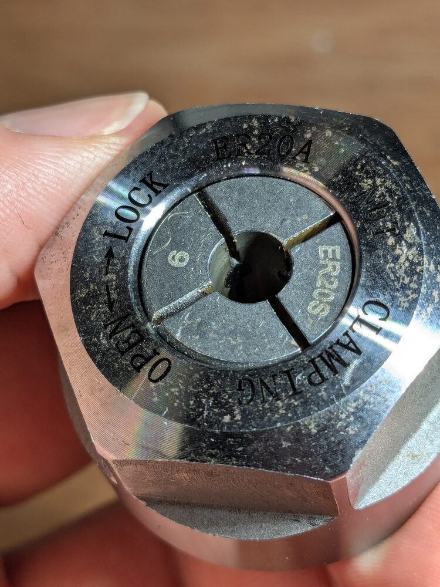
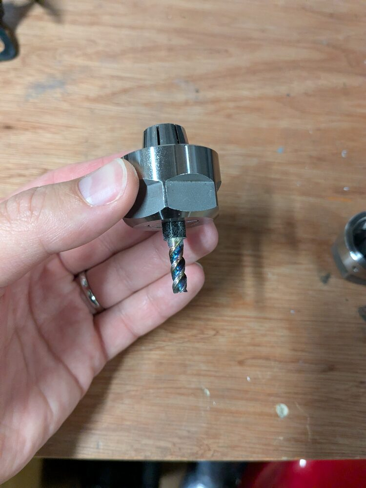
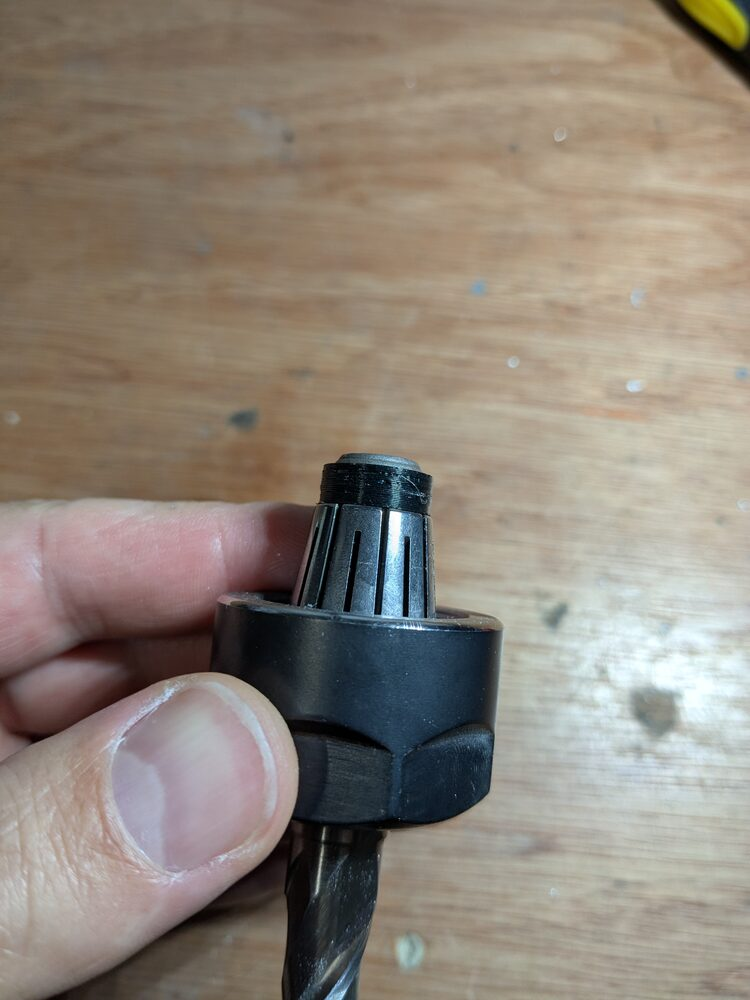

# Keeping the tool in the collet

During a change the collet nut is being screwed on or off while the spindle turns. For a moment the
collet is not gripping the shank, and the tool can slide in it — down and out of the collet when
unloading, or up into the spindle when the nut is threaded on. Over many cycles this shows up as the
tool [creeping in the collet](troubleshooting.md#the-tool-creeps-up-in-the-collet).

In practice it is a problem for tools **larger than about 4 mm**. Smaller tools are light enough
that the collet's residual grip holds them.

There are two fixes. Try the first one; add the second for the tools it does not hold.

---

## 1. Sealed collets

Use precision ER20 collets with **rubber inserts in the slots** — sold as *sealed* or *coolant*
collets (often marked with an `S`, e.g. `ER20S`). The rubber is there to stop coolant reaching the
spindle taper, but it also keeps a light grip on the shank while the nut is loose.

This is enough for most tools on its own. For large tools, or if the tool still moves, add the
retention rings below.

## 2. TPU retention rings

A pair of thin printed TPU sleeves on the shank, one each side of the collet, trap the tool axially
so it cannot move relative to the collet even while the collet is open. In use on the development
machine they have held every tool tried, including the ones the sealed collets did not.

| Ring | Where it goes | Stops the tool moving |
|---|---|---|
| Lower | On the shank just below the collet, inside the nut's front opening | Up into the spindle (Z+) |
| Upper | On the end of the shank where it comes out of the back of the collet | Down out of the collet (Z−) |

### Fitting

1. Print two rings for the shank size (STEP files in
   [`hardware/step/retention-rings/`](../hardware/step/retention-rings/), 3–13 mm).
2. Slide the upper ring onto the end of the shank and push the shank into the collet until the ring
   sits against the back of the collet.
3. Fit the lower ring onto the shank from the cutting end and push it up against the front of the
   collet.
4. Put the tool and collet into the nut as normal, then set the tool length.

The rings are **undersized** so they are a tight push fit on the shank — print them as they are, do
not scale them. Settings are in [`hardware/README.md`](../hardware/README.md#tool-retention-rings).

### Check before relying on them

- **The shank must come out of the back of the collet** far enough to take the upper ring (5 mm).
  A short-shank tool set deep in the collet has nowhere to put it.
- **The upper ring goes up into the spindle bore with the collet.** Check your spindle has clearance
  behind the collet before the first automatic change.
- **The lower ring sits in the nut's front opening and passes through the module.** Run one manual
  load/unload with the ring fitted before trusting it in an automatic cycle.
- Keep measuring tool length after each change. The rings stop the tool moving during a change,
  but a tool length offset is still only as good as the last measurement.
